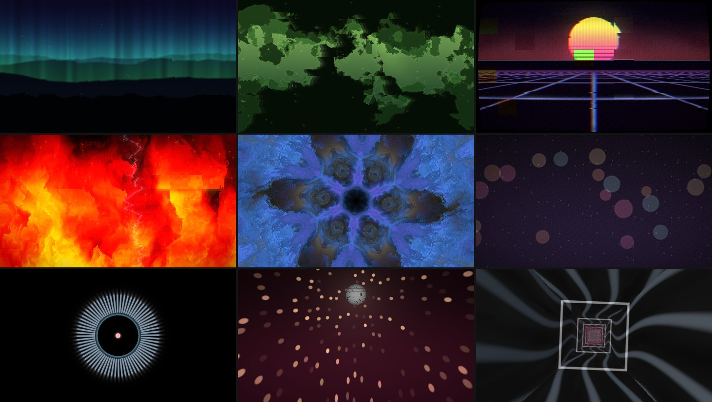

# Visual Engine (working title)

**Live visuals that listen to the music.** A free, open-source desktop app for
Windows. It analyses sound in real time (kicks, snares, hats, tempo, builds, drops)
and lets that drive anything you see. Your own photos, videos, webcams and shaders are
all wired together in one node graph, in the style of DaVinci Resolve.

Made for VJs, DJs, streamers and musicians who want visuals that move *with* a track,
not just alongside it.

> **Status: early, in active development.** It runs and is fun to play with, but it
> isn't a finished release yet. There are no ready-made downloads: a setup script
> builds it from the source code for you ([3 steps](#install-3-steps)). Settings and
> saved files may change between versions.



*Some of the built-in scenes. Every one reacts to the music.*

---

## What it does

- **Hears the music properly.** Spectrum, 32 bands, plus sub / bass / mids / highs.
  Kick, snare and hat hits. Tempo, and where you are in the beat, bar and phrase.
  It spots builds, drops and section changes. Levels auto-adjust to each song, so
  "1.0" always means "typical for this track".
- **Any sound source.** A song file (MP3, WAV, FLAC, OGG), a microphone or line-in,
  or whatever your computer is playing (Spotify, a DJ app, a browser).
- **One node graph.** Sources (shader scenes, pictures, videos, cameras) flow through
  effects into the output. Any setting can follow the music: wire a signal into it, or
  use the modulation editor (curves, beat envelopes, LFOs locked to the bar, steps).
- **Compositing.** All 21 Photoshop-style blend modes (Screen, Multiply, Overlay,
  Hard Light, Colour, Luminosity…). A Layer Mixer with solo, mute and reorder. A mask
  plug on every node, with Shape and Gradient masks that pulse to the beat, Luma and
  Chroma (green screen) keys, a Motion Mask that follows movement, and a Key Mixer.
  Move, scale, turn or corner-pin a picture by dragging handles in the viewer.
  Right-click the graph → *Add compositing demo* to see it all at once.
- **Media.** Pictures, video files (loop, ping-pong, beat-locked, scrub, stutter) and
  live webcams. Movement, brightness and colour seen in a video or camera become
  signals too.
- **Built for playing live.** Undo everything, autosave, groups with macro knobs, a
  live preview on each node, GPU cost per node, and a sound-to-picture sync test.
  A broken shader never stops the show: it keeps its last good picture.

Coming next is listed in the [Roadmap](#roadmap).

## Contents

- [Install (3 steps)](#install-3-steps)
- [Your first 5 minutes](#your-first-5-minutes)
- [Updating](#updating)
- [If something goes wrong](#if-something-goes-wrong)
- [Check the code yourself](#check-the-code-yourself)
- [Finding your way around](#finding-your-way-around)
- [Roadmap](#roadmap)
- [For developers](#for-developers)

## Install (3 steps)

Runs on **Windows 10 and 11** (64-bit). You need about **10 GB free** and an
internet connection for the first setup. The first setup takes **15–30 minutes**,
mostly downloads and the first build. After that the app starts in seconds.

**1. Download.** On this page click the green **Code** button → **Download ZIP**.
Right-click the ZIP → **Properties** → tick **Unblock** (bottom right) → **OK**.
Then right-click it → **Extract All…** → **Extract**.

**2. Double-click `setup.bat`** in the extracted folder. It installs what the app
needs, skipping anything you already have, then builds the app:

| What | Why | Size |
|---|---|---|
| Microsoft C++ Build Tools | the compiler Rust uses on Windows | 2–6 GB |
| Rust | the language the app is written in | about 1 GB |
| ffmpeg | plays video files (optional) | about 200 MB |

All three come from **winget**, Windows' own package manager, from their official
publishers. You can read [`setup.ps1`](setup.ps1) first: it is short and commented.

- If Windows says **"Windows protected your PC"**, click **More info** → **Run anyway**.
- When Windows asks **"Do you want to allow this app to make changes"** (for the
  Build Tools), click **Yes**. A Visual Studio Installer window shows its progress.
- Wait for the green **"All set"** line, then press any key to close the window.

**3. Double-click `run.bat`** to start Visual Engine. Use it every time you want to
start the app (make a desktop shortcut to it if you like).

<details>
<summary>Prefer to install by hand?</summary>

1. Install "Build Tools for Visual Studio" from
   <https://visualstudio.microsoft.com/visual-cpp-build-tools/> and tick
   **Desktop development with C++**.
2. Install Rust with `rustup-init.exe` from <https://rustup.rs> (accept the defaults).
3. Optional, for video files, in **Terminal**: `winget install Gyan.FFmpeg`
4. Get the code (ZIP as above, or `git clone https://github.com/HAVEKAUTION/Visual-Engine.git`).
5. Open **Terminal** in that folder (right-click the folder → *Open in Terminal*) and run
   `cargo run --release`

</details>

## Your first 5 minutes

1. **Give it sound.** Click the **Sources** tab (top left). Either click
   **Open song…** and pick an MP3 / WAV / FLAC / OGG, or click **Computer audio**
   and play music in Spotify, YouTube or a DJ app. The meters along the bottom start
   moving, and the BPM appears after a few seconds.
2. **See the demo.** Right-click the empty grey area of the **Node Graph** (bottom)
   → **Add compositing demo**. The viewer fills with layered, beat-driven visuals.
3. **Use your own pictures.** Click the **Media** tab → **Import…** and pick a few
   pictures and videos. Add the demo again: it uses up to 2 videos and 3 pictures.
4. **Change things.** Click any node in the graph. Its settings appear in the
   **Inspector** (right), with a short "How to use" note. Right-click a node to see
   everything you can do with it.
5. **Arrange the screen.** Drag any panel's tab to move it. **Layout** (top left)
   has ready-made arrangements, and **Panels** brings back anything you hid.

Want to help test? Each feature has a tick-list in [`TESTING.md`](TESTING.md).
Problems and ideas are welcome as
[issues](https://github.com/HAVEKAUTION/Visual-Engine/issues).

### Handy extras

- Open a song straight away: drag it onto `run.bat`, or drop it onto the app window.
- Analyse songs without opening the window. This writes `<song>.analysis.csv` next
  to each one: `cargo run --release -- --analyse "a.mp3" "b.flac"`
- Keep a test session's settings and files separate from your real ones: set the
  environment variable `VISUAL_ENGINE_DATA` to a folder before starting.

## Updating

Download the ZIP again and extract it over the old folder (or `git pull` if you used
git), then double-click `run.bat`. It rebuilds the changed parts by itself, which
takes a minute or two. Your settings, media list and autosaved graph are kept: they
live in your user folder, not in the app's folder.

## If something goes wrong

| What you see | What to do |
|---|---|
| "winget is missing" | Open the **Microsoft Store**, search **App Installer**, install or update it, run `setup.bat` again. |
| "Windows protected your PC" | **More info** → **Run anyway**. Or unblock the ZIP before extracting (step 1). |
| Setup stopped at the C++ Build Tools | Install them by hand (see *Prefer to install by hand?*), then run `setup.bat` again. |
| "Rust isn't installed yet" from `run.bat` | Run `setup.bat` first. If you just ran it, restart the PC once. |
| `link.exe not found` while building | The C++ Build Tools are missing: run `setup.bat` again. |
| "Video needs ffmpeg" in the app | In **Terminal**: `winget install Gyan.FFmpeg`, then restart the app. |
| No sound reaction | **Sources** tab: pick an input and press **Start input**, or **Computer audio**. Check Windows' sound settings use the device you expect. |
| Camera doesn't show | **Sources** tab → the refresh button next to **Cameras**. Close other apps using the camera (Teams, Zoom, OBS). Check Windows Settings → Privacy → Camera allows desktop apps. |
| A panel disappeared | **Panels** menu: tick it. Or **Layout** → **Reset**. |
| Anything else | Open an [issue](https://github.com/HAVEKAUTION/Visual-Engine/issues) and paste the messages from the black window. |

## Check the code yourself

You're running software from the internet, so here is how to see what it is and what
it does.

- **It's all here.** Everything the app does is in this repository, and you build it
  yourself from that code. Nothing is downloaded at run time, and there are no
  pre-built binaries to trust.
- **No internet, no tracking.** The app makes no network connections: no telemetry,
  no accounts, no update checks. You can confirm this. Search the code for network
  libraries (`reqwest`, `ureq`, `hyper`, `TcpStream`): there are none. The full list
  of libraries it uses is in `Cargo.lock`.
- **What it touches on your computer:**
  - songs, pictures and videos you open (read only);
  - the microphone, line-in, camera or computer audio, only when you pick one;
  - its own settings and autosave folder;
  - `.analysis.csv` files, only if you run `--analyse`.

  It runs `ffmpeg` as a separate program to read video files.
- **The setup script** ([`setup.ps1`](setup.ps1)) only installs the three tools
  listed above through winget, then runs `cargo build --release`. `run.bat` only
  runs `cargo run --release`.
- **Run the tests.** About 165 automated checks cover the audio maths, the graph, the
  blend modes (compared pixel by pixel on your graphics card) and more:

  ```
  cargo test --workspace
  ```

- **Check the libraries for known security problems** (optional):

  ```
  cargo install cargo-audit
  cargo audit
  ```

- **Match a version.** Each change is a git commit. `git log` lists them, and
  `git checkout <commit>` builds exactly that version.

## Finding your way around

```
┌──────────────┬──────────────────────────────────┬──────────────┐
│ SOURCES |    │             VIEWER               │  INSPECTOR   │
│ MEDIA | ...  │  what the audience sees, or the  │  settings of │
│ (tabs)       │  selected node, wipe, PiP        │  the node    │
│ cameras;     │                                  │  you clicked │
│ song & input │                                  │              │
├──────────────┴──────────────────────────────────┴──────────────┤
│ NODE GRAPH: right-click to add nodes, drag from a plug to wire │
├────────────────────────────────────────────────────────────────┤
│ SIGNAL STRIP: bass, mids, highs · kick / snare / hat · BPM     │
└────────────────────────────────────────────────────────────────┘
```

- Every panel is a tab you can drag: drop it on another panel to join its tabs, or
  on an edge to split. Drag the gaps to resize. Your arrangement is remembered.
- **Layout** (top left) switches between Build, Perform and Stream, or resets.
  **Panels** shows or hides any panel. If one is missing, tick it there.
- **Theme** changes the look: Ember, Graphite, Neon or High contrast (bigger text),
  or **Edit colours…** to make your own. Themes are small text files you can share
  (Theme → Open themes folder / Import).
- **Sound source:** the **Sources** tab on the left: **Open song…**, the live
  inputs, **Computer audio**, and your cameras.
- **Settings for a node:** click the node in the graph. Its settings appear in the
  **Inspector** on the right, with a short "How to use" note and buttons to add an
  effect, a layer or a mask. With nothing selected, the Inspector shows getting-started
  steps.
- **Right-click a node** for everything you can do with it.
- Press **?** for every keyboard shortcut. **Tab** hides or shows the graph, and
  **F11** goes fullscreen.

A guided tutorial inside the app is planned (see the roadmap).

## Roadmap

Done:
- the analysis engine;
- the node graph and workspace;
- media (pictures, video, cameras);
- compositing: blend modes, the Layer Mixer, masks and keys, Transform and Corner
  Pin with handles in the viewer, and a demo project;
- the workspace: dockable panels, layouts, a Sources panel and themes.

Next, roughly in order:

1. **Looks and the full node library.** Signature looks you can mutate and breed,
   ready-made node layouts in the right-click menu, more original effects (datamosh,
   liquify, a symmetry engine), text, depth, and a free pack of starter pictures.
2. **Perform mode.** Macros, MIDI learn and controller support, an automatic
   "Director", a photosensitivity safety guard, and a panic key.
3. **Outputs.** Second screen and projectors (with warping), Spout / Syphon / NDI for
   OBS, and a live desktop wallpaper mode.
4. **Video intelligence.** Motion tracking, and keying people out without a green screen.
5. **Export.** 4K, vertical and square video and loops, with the song or the live
   audio, plus Ableton Link.
6. **Tutorial** inside the app.

Ideas for later: stems (separate drums / bass / vocals as their own signals) and
sampling, lyric tracks, DMX lighting, OSC, a phone remote, and sharing Looks.

The detailed plan is in [`DIRECTION_UPDATE_v2.md`](DIRECTION_UPDATE_v2.md), and what
changed when is in [`CHANGELOG.md`](CHANGELOG.md).

## For developers

Rust (2024 edition), [wgpu](https://wgpu.rs) with WGSL shaders, egui / eframe for
the UI, cpal for audio, symphonia for decoding, realfft, nokhwa for cameras, ffmpeg
for video.

```
crates/
  app/        the program: window, workspace, node editor, inspector
  audio/      song decoding, playback, live and computer-audio input, click track
  analysis/   pure DSP: spectrum, bands, onsets, tempo, beat phase, structure
  graph/      node graph data model: typed plugs, wires, groups, undo, save / load
  nodes/      node types and the graph evaluator (runs the graph on the GPU)
  media/      pictures, video (ffmpeg), cameras, video signals
  signals/    the signal bus and the modulation rule
  render/     wgpu renderer, texture pool, feedback buffers
  scenes/     shader scenes, the WGSL prelude, blend maths, hot reload
```

How audio flows:

```
song file ──decode+resample (loader thread)──► Song (stereo @ device rate + mono @ 48 kHz)
                                                 │
               output callback: plays stereo, pushes matching 48 kHz mono
                                                 ▼
live input ──input callback: mono mix → 48 kHz──► rtrb ring buffer ──► analysis thread
                                                                        │ triple buffer
                                                                        ▼
                                                                    UI / renderer
```

Rules the code keeps:
- Audio callbacks never allocate, lock, log or touch files.
- Analysis is pure and deterministic, so it runs the same live and offline.
- The output never waits for the UI, file loading or a bad shader.

Writing your own scenes: [`docs/SCENES.md`](docs/SCENES.md). The brief and working
rules: [`CLAUDE.md`](CLAUDE.md). Manual test checklists: [`TESTING.md`](TESTING.md).

Before sending changes:

```
cargo fmt
cargo clippy --workspace --all-targets -- -D warnings
cargo test --workspace
```

## Licence

Dual-licensed under [MIT](LICENSE-MIT) or [Apache 2.0](LICENSE-APACHE), at your
option. This is the usual choice for Rust projects.

## Credits

Designed and play-tested by HAVEKAUTION. The code is written with
[Claude Code](https://claude.com/claude-code).
